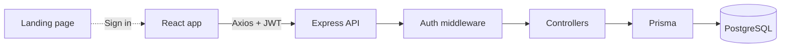

<div align="center">

# Praeso

**The complete system to stop appointment no-shows.**

Manage clients, track confirmations, and follow your numbers in real time.

<br />

[](https://react.dev)
[](https://vitejs.dev)
[](https://tailwindcss.com)
[](https://nodejs.org)
[](https://www.prisma.io)
[](https://supabase.com)

<br />

[About](#-about) · [What's inside](#-whats-inside) · [Features](#-features) · [Tech stack](#-tech-stack) · [Architecture](#-architecture) · [Security](#-security) · [Getting started](#-getting-started)

</div>

<br />

## ◆ About

A **no-show** happens when a client books an appointment and never shows up. It costs time and money.

**Praeso** is a complete system built to fight this. It keeps every appointment, confirmation, and status in one place, with a live dashboard that shows exactly where your schedule stands. A dedicated landing page presents the product to new customers.

<br />

## ◆ What's inside

| Part | Purpose |
|---|---|
| 🌐 **Landing page** | Presents the product, its benefits, and how it reduces no-shows |
| 📊 **Web app** | Dashboard to manage clients, appointments, and statuses |
| ⚙️ **API** | Authentication, business logic, and data access |

<br />

## ◆ Features

| | Feature | Description |
|:-:|---|---|
| 📊 | **Live statistics** | Monthly total, confirmed, pending, and no-shows at a glance |
| 🎯 | **Interactive filters** | Click any stat card to filter the appointment list below it |
| ⏳ | **Time remaining** | Each appointment card shows how long is left until the service |
| 🔄 | **Status management** | Switch quickly between Pending, Confirmed, and Completed |
| 👥 | **Client management** | Keep clients and their appointments organized |
| 🗂️ | **Soft delete** | Removed items keep their history, so monthly stats stay accurate |
| 🔐 | **Private by default** | Each user only sees their own data |

<br />

## ◆ Tech stack

| Layer | Tools |
|---|---|
| **Frontend** | React, Vite, Tailwind CSS, Zustand, Axios, Lucide React, date-fns |
| **Backend** | Node.js, Express, Prisma ORM |
| **Database** | PostgreSQL on Supabase |
| **Auth** | JWT and BcryptJS |

<details>
<summary><b>What each tool does</b></summary>

<br />

| Tool | Role |
|---|---|
| **Zustand** | Global state for auth and UI |
| **Axios** | HTTP client with interceptors for the JWT |
| **date-fns** | Date handling and the "time remaining" calculation |
| **Lucide React** | Icon set |
| **Prisma** | Type-safe database access |
| **JWT** | Stateless authentication between client and server |
| **BcryptJS** | Password hashing |

</details>

<br />

## ◆ Architecture

A classic **client-server** model.



**Client**
- Components request data through `appointmentsAPI` and `dashboardAPI`, defined in `src/services/api.ts`.
- The JWT is stored in `localStorage` and attached to every request automatically by an Axios interceptor.

**Server**
- Every request passes through an authentication middleware that validates the JWT.
- The **Dashboard Controller** runs Prisma queries to calculate monthly stats, confirmation rates, and pending appointments.
- **Soft delete:** instead of being removed, records are flagged as `isDeleted`. This preserves history for the monthly statistics.

<br />

## ◆ Security

| Measure | How it works |
|---|---|
| **Secrets protection** | `.gitignore` keeps API keys and `.env` files out of the repository |
| **Password hashing** | Passwords are never stored as plain text |
| **Protected routes** | Appointment routes can only be accessed by the data owner |

<br />

## ◆ Getting started

```bash
git clone https://github.com/joaogalimberti/no-show-reducer.git
cd no-show-reducer
```

**Backend**

```bash
cd backend
npm install
npx prisma migrate dev
npm run dev
```

**Web app**

```bash
cd frontend
npm install
npm run dev
```

**Landing page**

```bash
cd landing
npm install
npm run dev
```

**Environment variables**

| Variable | Where | Purpose |
|---|---|---|
| `DATABASE_URL` | backend | PostgreSQL connection string (Supabase) |
| `JWT_SECRET` | backend | Secret used to sign tokens |
| `VITE_API_URL` | frontend | Base URL of the API |

Create a `.env` file in each folder with these values. They are ignored by Git.

<br />

<div align="center">

Made by [João Galimberti](https://github.com/joaogalimberti) · [LinkedIn](https://www.linkedin.com/in/joaogalimberti/) · [Email](mailto:joaogalimberti@gmail.com)

*Built with a focus on premium aesthetics and performance.*

</div>
